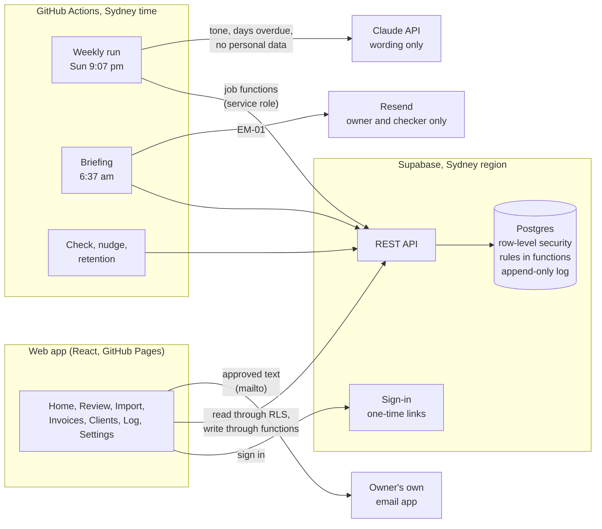

# Get-Paid Apprentice

Get-Paid Apprentice drafts payment reminders in the owner's voice and a Monday briefing for small construction businesses, and nothing reaches a client until the owner or a named checker approves it. This repository holds the database, the scheduled jobs, the AI prompt and the plan for the proof of concept (PoC) built by Team W14A-5 for INFS3605 at UNSW, Term 3 2026.

**Status, Thu 15 Oct 2026:** the backend and the web app are built and tested. The backend has 235 database tests, 34 job tests, an end-to-end check, and a check of the demonstration and onboarding scripts. The web app (`web/`) has 21 unit tests and 45 browser tests, each run on a phone and a computer screen, with accessibility checks, plus 6 tests of the site as GitHub Pages serves it, including the speed budgets. Next: link GitHub, set up the Supabase projects and publish (`docs/runbook.md`). All data in this repository is synthetic and labelled "Test data".

**Product documents** (Claude Docs in Adam's account; ask him to share them with you): [PRD](https://claude.ai/code/artifact/4d00db9a-df6a-4d9d-b8a2-e030d57a5adf) for what and why, [TRD](https://claude.ai/code/artifact/7d113434-7532-4f15-8727-e2046bee1ecd) for how it is built, [App Flow](https://claude.ai/code/artifact/652cbc3c-237c-4b00-bdfa-624ca2eb94c1) for every journey and state, [UI design brief](https://claude.ai/code/artifact/1b7ffba8-ce51-4ce3-814f-a063abf0b3d2) for the look, words and accessibility, and [Implementation plan](https://claude.ai/code/artifact/023fe09a-0811-4956-9b94-19c9fe6e43ac) for who builds what, when. The [click-through preview](https://claude.ai/artifact/57vj9r12YxibBbvZfVkNsK) runs this repository's migrations in the browser with Test data (`web/README.md`).

## How it works



The browser never holds a secret: it uses the public key, and row-level security plus role checks in every function decide what each person may do. Only the jobs hold the service, AI and email keys. The AI writes wording with placeholders; the database fills in the facts after a person approves.

## Quick start

You need Node 22.18 or later and either the Supabase CLI with Docker, or a plain PostgreSQL 15+ server with pgTAP.

```bash
npm ci                      # TypeScript and Node types, for checking only
npm test                    # type check and the 34 job tests

# With the Supabase CLI and Docker
supabase start              # local stack with the migrations and the Test data seed
supabase test db            # the 235 database tests

# Without Docker (any PostgreSQL 15+ with pgTAP)
PGHOST=localhost PGUSER=postgres scripts/test-local.sh   # migrations, seed, database tests, then the end-to-end and scripts checks
```

To run a job locally, copy `.env.example` to `.env`, fill it in from `supabase status`, then `npm run job:weekly-run -- --business=0d5e0000-0000-4000-8000-000000000001 --force`. Without an AI key, drafts use the fallback templates; without an email key, emails are printed.

To run the web app against a local stand-in for Supabase (no Docker):

```bash
(cd web && npm ci)
PGHOST=localhost PGUSER=postgres npm run stack   # the migrations and seed behind PostgREST on http://127.0.0.1:54321
cd web && npm run dev                             # http://127.0.0.1:5173; sign in as owner@example.test
```

The sign-in code is at http://127.0.0.1:54321/__local/codes?email=owner@example.test. See `web/README.md` for the tests and builds.

## What is where

| Path | What |
| --- | --- |
| `supabase/migrations/` | Seven migrations: types, tables, helpers, triggers, row-level security, the app's functions, the jobs' functions |
| `supabase/seed.sql` | One synthetic business with 12 open invoices and 5 drafts, all labelled Test data |
| `supabase/tests/database/` | pgTAP tests, named by the requirement or acceptance test they prove |
| `jobs/` | Weekly run, briefing, briefing check, nudge, health check and retention; prompt evaluation |
| `prompts/` | The versioned AI prompt, its output schema and 30 evaluation cases |
| `.github/` | CI, the scheduled workflows, the web app's deploy to GitHub Pages, issue and pull request templates, Dependabot |
| `web/` | The web app (React, Vite and TypeScript): screens UI-01 to UI-11, unit and end-to-end tests, the click-through preview |
| `planning/backlog.csv` | The product backlog, 79 items: owner role, size, hours, sprint, dependency, acceptance reference and a one-line "done when" |
| `scripts/` | Local test runner, end-to-end check, hygiene check, GitHub bootstrap, data dictionary, demonstration import and inboxes, owner onboarding, the web app's database types, and the local stack for the web app (`scripts/local-stack/`) |
| `docs/` | Data model, security model, lifecycles, API, rules-to-tests map, runbook, decision records |

## Working in this repository

- One issue per requirement or screen, named by its ID ("FR-14 Review one draft at a time"). `scripts/bootstrap-github.sh OWNER/REPO` creates them from the backlog.
- One branch per issue; a pull request names the IDs it covers and needs one review and green checks to merge into `main`.
- Definition of done: meets its acceptance criteria with tests passing; reviewed and merged; works at 360 px and passes the accessibility checks for its screen; no personal data in code, issues or logs; the pull request names its IDs.
- See [CONTRIBUTING.md](CONTRIBUTING.md) for the details and [SECURITY.md](SECURITY.md) for secrets and data.

## Rules this repository follows

- Private repository; code and Test data only. No course materials, interview records or participant data (CM-3).
- No real names, emails, invoices or screenshots in code, tests, issues or pull requests (NFR-04). The hygiene check fails the build on real-looking emails and keys.
- Keys live only in GitHub Actions secrets or a local `.env` that git ignores (NFR-06).
- Test data is deleted within 2 weeks of its testing, and all business data by Thu 31 Dec 2026 (NFR-03, PD-7).

## Not licensed for reuse

This is coursework for INFS3605 at UNSW. All rights reserved by Team W14A-5.

AI use: Team W14A-5 used [AI tools: completed at final assembly] to help draft and structure this document and to write and test the code in this repository. Every claim, figure and quote was checked against its source by a team member, and the team takes responsibility for the content.
