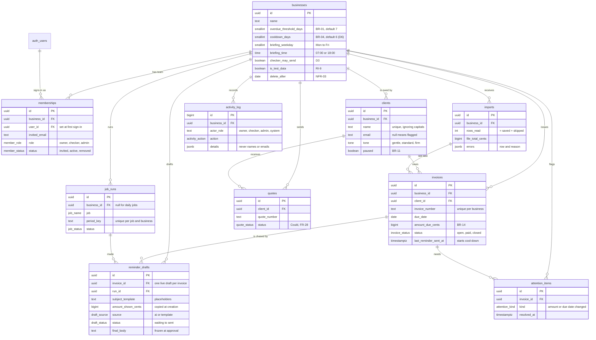

# Data model

Eleven tables hold everything, and every business-owned row carries `business_id`, so one database serves many businesses and a bookkeeper can later check for several builders. Amounts and dates live only in `invoices`; a draft copies the amount, number and due date when it is made, so any later change is caught before anything is sent (BR-05).

Two more tables are not shown: `deletion_receipts` (proof of deletion, counts only, readable by the team only) and, in the private schema, `banned_phrases` and `reminder_templates`. Every column is described in [data-dictionary.md](data-dictionary.md), which is generated from the database.

## Rules the structure enforces

| Rule | How the database holds it | Test |
| --- | --- | --- |
| Money is exact (BR-14) | `bigint` cents; amounts must be more than 0 | 001, 010 |
| "Overdue" is never stale (BR-06) | No stored overdue flag; days overdue come from `private.days_overdue` in Sydney dates | 001, 010, 060 |
| One reminder in flight per invoice (AT-08) | Partial unique index `reminder_drafts_one_live` on waiting and approved drafts | 020 |
| Facts cannot drift (BR-05) | Drafts copy number, amount and due date; a trigger freezes them; approval re-checks them | 030, 040 |
| What was approved is what is sent (FR-15) | `final_subject` and `final_body` are written once at approval and frozen by a trigger | 040 |
| The log is permanent (FR-21) | Append-only trigger for every role; no update or delete privilege, even for the service role | 050 |
| Jobs never repeat (NFR-09) | `job_runs` unique on job, business and period | 020, 070 |
| Real data has a written agreement and a deletion date (D7, NFR-03) | Check constraints on `businesses`; nothing may be kept past Thu 31 Dec 2026 | 050, 070 |
| One owner and at most one checker | Partial unique indexes on `memberships` | 050 |

## Why these choices

- **Multi-business from day one.** It costs one column per table and avoids a risky migration when a bookkeeper checks for several builders (PRD section 17). See [ADR 0002](adr/0002-multi-business-from-day-one.md).
- **Writes through functions.** Each write checks the role and logs in the same transaction, so the log cannot miss an action. See [ADR 0003](adr/0003-reads-through-rls-writes-through-functions.md).
- **Placeholders in drafts, filled at approval.** The AI never sees a fact, and the approved text is frozen exactly. See [ADR 0005](adr/0005-placeholders-and-locked-facts.md).
- **Missing emails are calculated, changed amounts are stored.** Fixing an email clears its flag at once; an amount change is an event the owner should see until a new draft replaces it.

## Indexes

Every foreign key has an index, and every policy column (`business_id`) leads at least one index. The briefing reads `invoices (business_id, status, due_date)`; the review queue reads `reminder_drafts (business_id, status)`; the log reads `activity_log (business_id, at desc)`.
