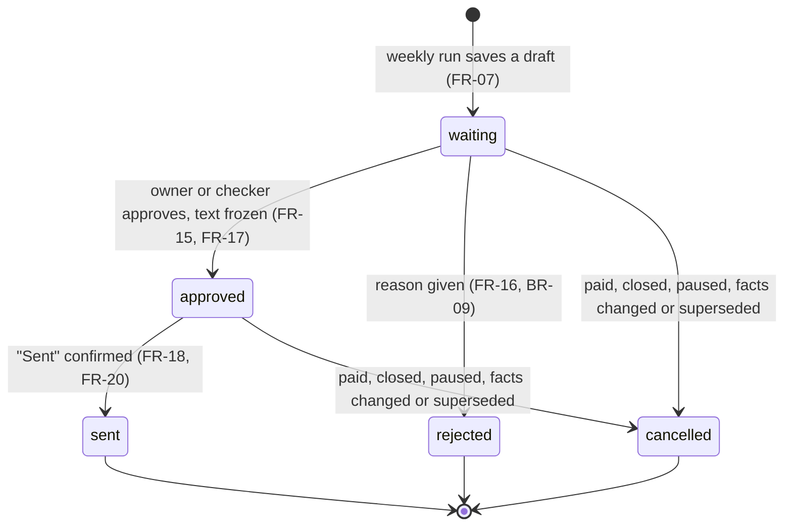
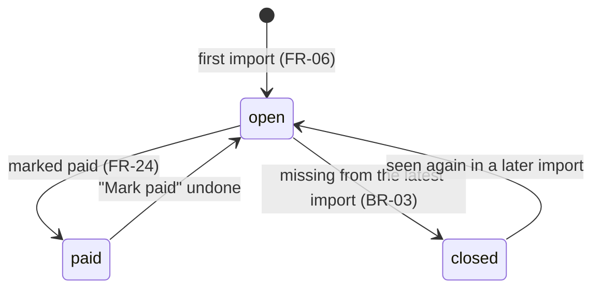
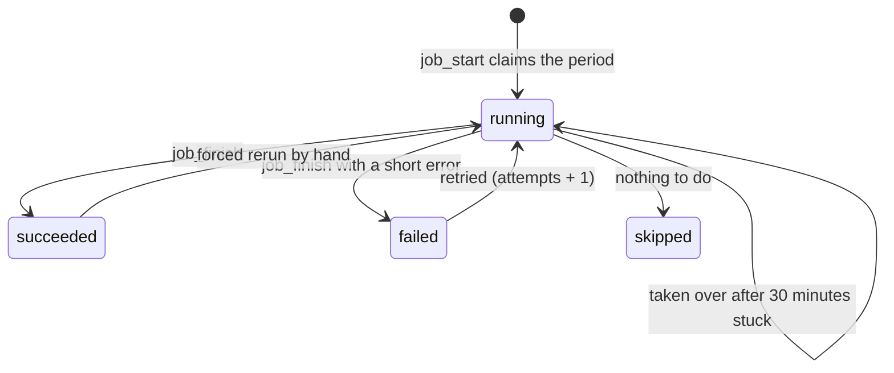
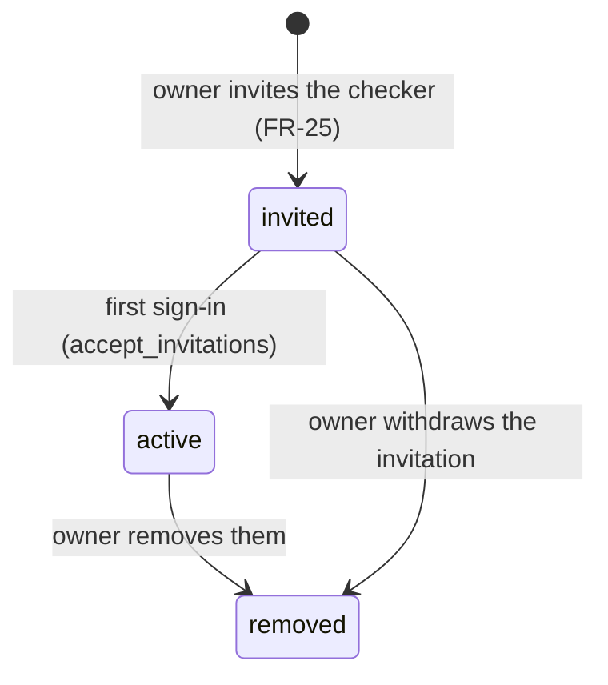

# Lifecycles

Each record moves only along the arrows below. Triggers enforce the arrows for every writer, including the service role, so a bug in the app or a job cannot skip a step.

## Reminder draft

The approval gate (FR-17, BR-02, AT-01): there is no arrow from `waiting` to `sent`.

| Cancel reason | When | Rule |
| --- | --- | --- |
| `invoice_paid` | A person marks the invoice paid | BR-03, FR-24 |
| `invoice_closed` | The invoice is missing from the latest import | BR-03 |
| `amount_changed`, `due_date_changed` | An import or approval finds the facts no longer match | BR-05, AT-03 |
| `client_paused` | The owner pauses the client | BR-11 |
| `email_missing` | Approval finds the client's email gone | BR-05 |
| `superseded` | The next weekly run replaces last week's draft, so days overdue stay true | BR-10 |

BR-10 is applied to approved drafts that were never sent as well as waiting ones, because their frozen text states last week's days overdue. The Send screen warns about this when the user taps "Not yet".

## Invoice

"Overdue", "due soon" and "due" are display states calculated from the due date in Sydney time (BR-06), never stored. A paid invoice that still appears in an export stays paid: Xero may not have caught up.

## Scheduled job run

One row exists per job, business and Sydney date (for the weekly run, the Sunday). A second scheduled start for the same period does nothing, which makes every job safe to repeat (NFR-09).

## Team membership

The owner's membership starts `active` when they create the business, or `invited` when the team sets the business up for them.
